# Image Metadata API – Infraestructura Serverless en AWS

**Asignatura:** INY1106 – Infraestructura de Aplicaciones II
**Evaluación:** Parcial N°2 – Infraestructura Serverless (35 %)
**Estudiante:** Albert Ruiz
**Fecha:** 30/10/2026
**Entorno:** AWS Academy Learner Lab · región `us-east-1` (N. Virginia) · rol IAM `LabRole`

Este repositorio es el **informe técnico (Wiki pública)** de la evaluación. Documenta paso a paso la implementación, en la Consola de AWS, de una API REST serverless que sube imágenes JPG a Amazon S3, guarda sus metadatos en Amazon DynamoDB y los consulta por API Gateway. Incluye capturas de evidencia, resultados de pruebas con Postman y el análisis de CloudWatch.

| Contenido | Ubicación |
|---|---|
| Informe (este documento) | `README.md` |
| Capturas de evidencia | [`evidencias/`](evidencias) |
| Código de las funciones Lambda | [`src/`](src) |
| Colección de Postman | [`postman/`](postman) |
| Guía detallada clic a clic y versión Word | [`docs/`](docs) |

---

## Índice
1. [Arquitectura](#1-arquitectura)
2. [Recursos implementados](#2-recursos-implementados)
3. [Bucket S3 (IE2.2.1)](#3-bucket-s3-ie221)
4. [Tabla DynamoDB (IE2.2.2)](#4-tabla-dynamodb-ie222)
5. [Funciones Lambda (IE2.1.1)](#5-funciones-lambda-ie211)
6. [API Gateway (IE2.2.3)](#6-api-gateway-ie223)
7. [Pruebas con Postman (IE2.3.1)](#7-pruebas-con-postman-ie231)
8. [Troubleshooting, monitoreo y rendimiento (IE2.3.2)](#8-troubleshooting-monitoreo-y-rendimiento-ie232)
9. [Seguridad](#9-seguridad)
10. [Conclusiones](#10-conclusiones)

---

## 1. Arquitectura

Diagrama oficial del proyecto: [`v-teacher/INY1106 › image_metadata_api_diagram.png`](https://github.com/v-teacher/INY1106/blob/main/image_metadata_api/img/image_metadata_api_diagram.png)

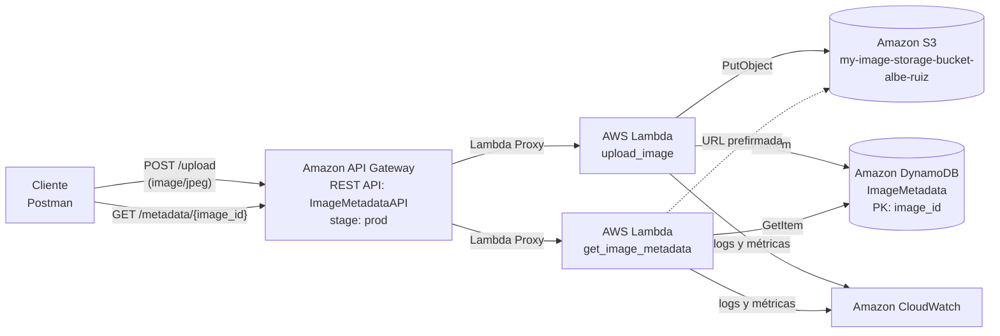

**Flujo:**
1. El cliente envía la imagen en binario a `POST /upload`.
2. `upload_image` valida que sea JPG, genera un `image_id` (UUID de 32 caracteres hexadecimales), guarda el objeto en S3 y registra los metadatos en DynamoDB. Responde `201` con el `image_id`.
3. El cliente consulta `GET /metadata/{image_id}`. `get_image_metadata` lee DynamoDB y responde con los metadatos y una URL prefirmada temporal para ver la imagen, porque el bucket es privado.
4. Ambas funciones registran logs y métricas en CloudWatch.

---

## 2. Recursos implementados

| Servicio | Recurso | Configuración |
|---|---|---|
| Amazon S3 | `my-image-storage-bucket-albe-ruiz` | us-east-1 · *Block all public access* · ACL deshabilitadas · SSE-S3 |
| Amazon DynamoDB | `ImageMetadata` | Partition key `image_id` (String) · capacidad **bajo demanda** |
| AWS Lambda | `upload_image` | Python 3.13 · `LabRole` · timeout **30 s** · 256 MB · `BUCKET_NAME`, `TABLE_NAME` |
| AWS Lambda | `get_image_metadata` | Python 3.13 · `LabRole` · timeout **30 s** · 256 MB · `TABLE_NAME` |
| API Gateway | `ImageMetadataAPI` (REST, Regional) | `POST /upload`, `GET /metadata/{image_id}` · Lambda Proxy · CORS · binary media type `image/jpeg` · stage `prod` |

**Invoke URL:** `https://4dv95hy648.execute-api.us-east-1.amazonaws.com/prod`

---

## 3. Bucket S3 (IE2.2.1)

Se creó el bucket con un nombre que **comienza con la nomenclatura `my-image-storage-bucket`** y un sufijo único (los nombres de S3 son globales). Está en `us-east-1`, con todo el acceso público bloqueado y cifrado SSE-S3. No necesita bucket policy: la Lambda escribe gracias a los permisos del rol `LabRole`.

| Nombre, tipo y región | Bloqueo de acceso público |
|---|---|
| 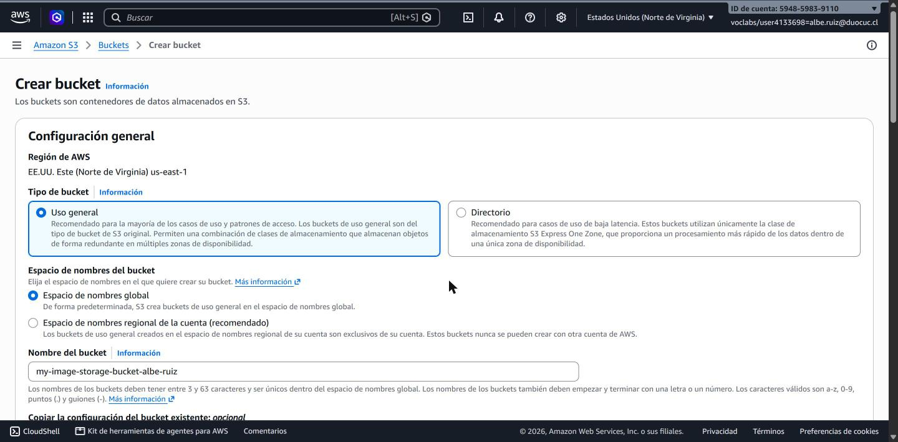 | 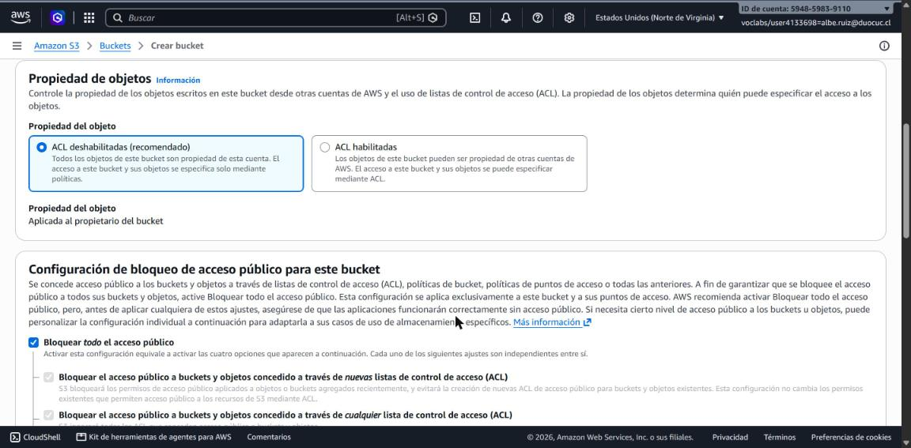 |

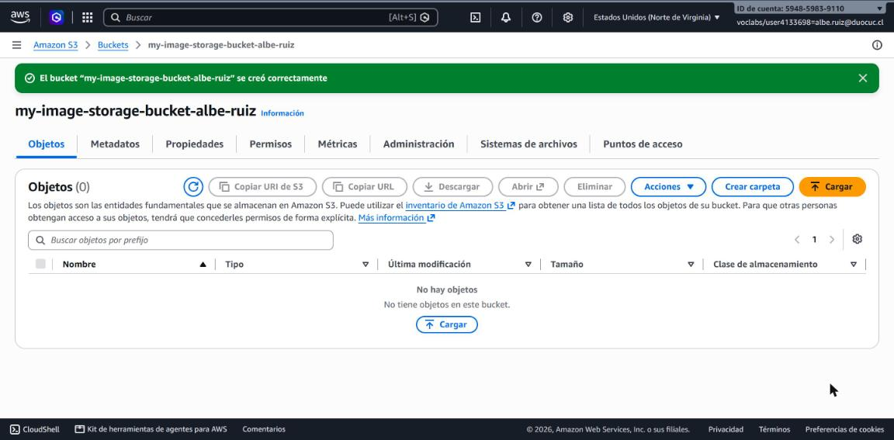

---

## 4. Tabla DynamoDB (IE2.2.2)

Tabla `ImageMetadata` con clave de partición `image_id` de tipo **String** y modo de capacidad **bajo demanda**: pago por solicitud, sin planificar capacidad, y escala automáticamente. La tabla quedó en estado **Activo**.

| Clave de partición `image_id` (Cadena) | Capacidad bajo demanda |
|---|---|
| 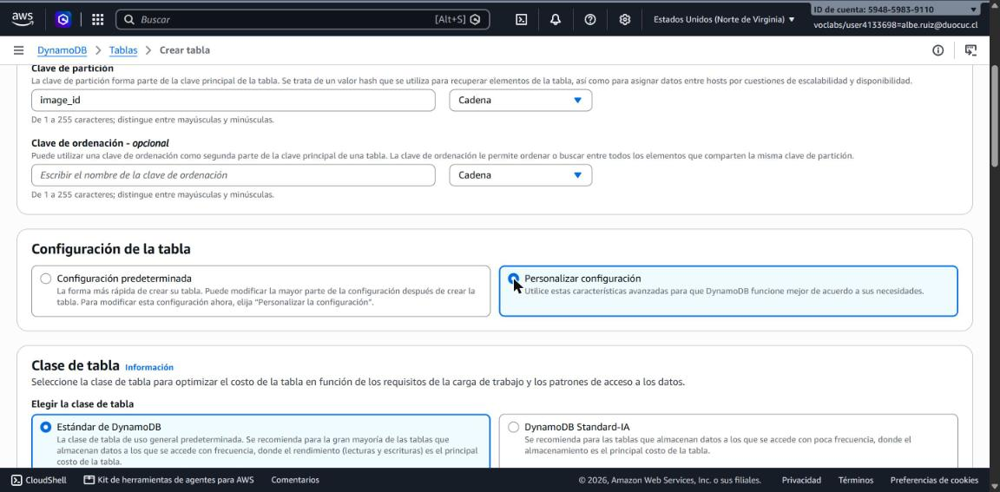 | 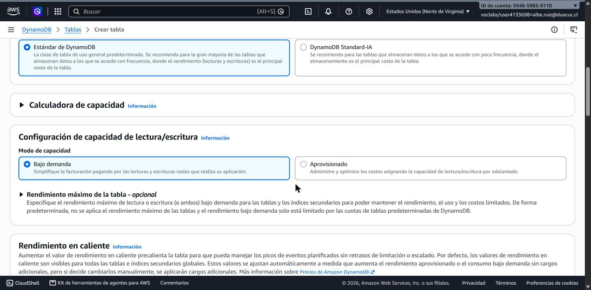 |

---

## 5. Funciones Lambda (IE2.1.1)

Ambas funciones se crearon desde cero con **Python 3.13** y el rol existente **`LabRole`**. El código está en [`src/`](src). Se cargó como `lambda_function.py` y se configuró el *handler* (`lambda_function.upload_image` y `lambda_function.get_image_metadata`).

### 5.1 `upload_image`

| Rol de ejecución `LabRole` | Código desplegado |
|---|---|
| 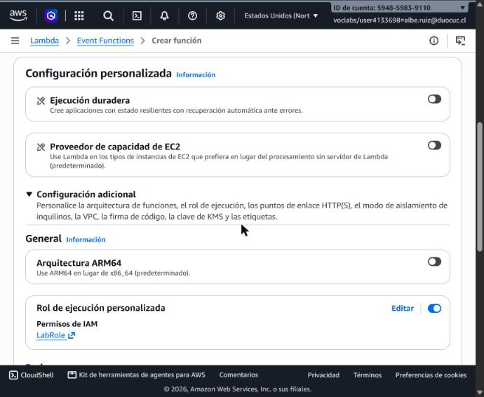 | 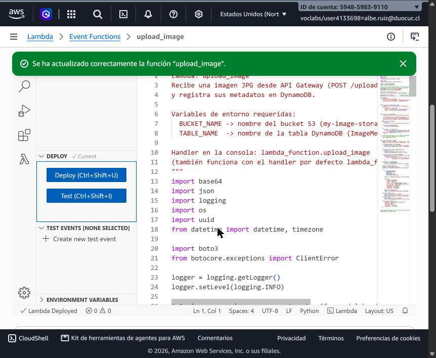 |

| Memoria 256 MB | Tiempo de espera 30 s |
|---|---|
| 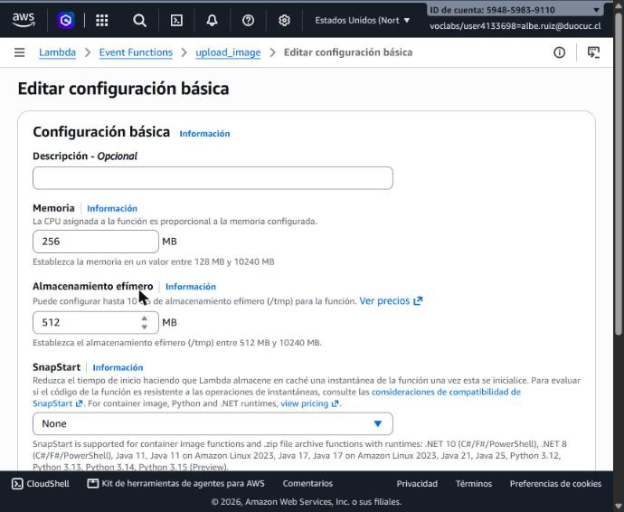 |  |

| Variables `BUCKET_NAME` y `TABLE_NAME` | Handler |
|---|---|
| 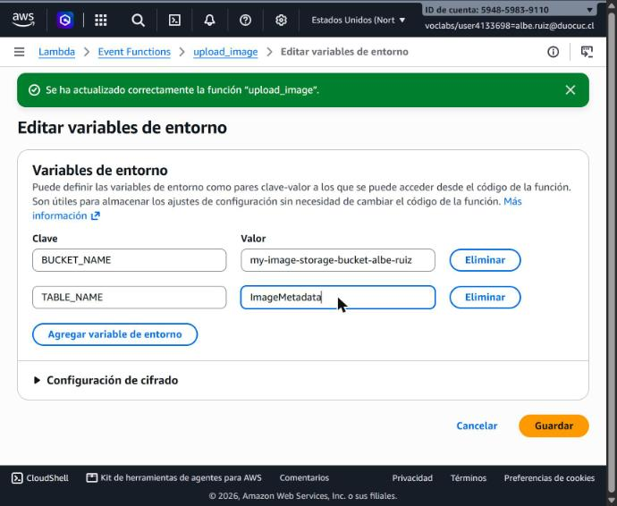 | 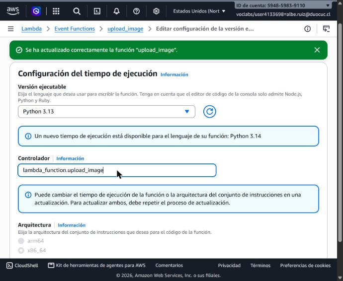 |

### 5.2 `get_image_metadata`

| Tiempo de espera 30 s y `LabRole` | Variable `TABLE_NAME` |
|---|---|
| 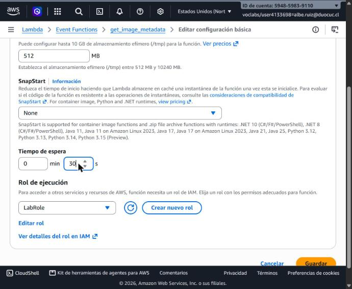 | 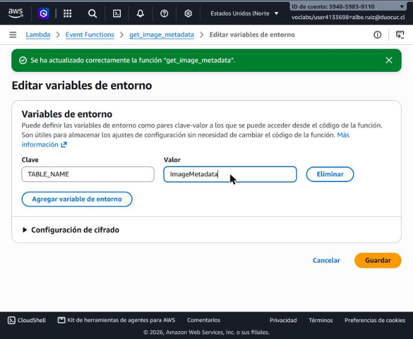 |

### 5.3 Mejoras al código base entregado

El código parte de [`upload_image.py`](https://github.com/v-teacher/INY1106/blob/main/image_metadata_api/src/upload_image.py) y [`get_image_metadata.py`](https://github.com/v-teacher/INY1106/blob/main/image_metadata_api/src/get_image_metadata.py) del curso, con estas mejoras:

| Problema en el código base | Solución aplicada |
|---|---|
| La respuesta del upload no devolvía el `image_id`, necesario para el GET | Se devuelve `image_id` en la respuesta |
| El cuerpo binario llega en base64 y se guardaba sin decodificar | Decodifica cuando `isBase64Encoded = true` |
| No validaba el tipo de archivo | Valida la firma JPEG `FF D8 FF`; si no coincide responde `415` |
| `event.get('pathParameters', {})` falla si llega `None` | `(event.get('pathParameters') or {})` y validación del formato del ID |
| Todos los errores devolvían 500 | Códigos HTTP correctos: 400, 404, 413, 415, 500, 502 |
| Sin cabeceras CORS ni `Content-Type` | Respuestas con CORS y `application/json` |
| `print()` sin contexto | `logging` con `request_id` y bytes recibidos (útil para diagnosticar en CloudWatch) |
| La URL pública no funciona con un bucket privado | El GET entrega una URL prefirmada temporal (1 h) |

---

## 6. API Gateway (IE2.2.3)

Se creó la REST API `ImageMetadataAPI` (Regional) con los recursos `/upload` (POST) y `/metadata/{image_id}` (GET). `{image_id}` es un **parámetro de ruta**. Ambos métodos usan **integración Lambda Proxy**. Se habilitó CORS y se agregó `image/jpeg` como **binary media type** para que la imagen no se corrompa al pasar por la API. La API se desplegó en el stage **`prod`**.

| Creación de la API | Árbol de recursos |
|---|---|
| 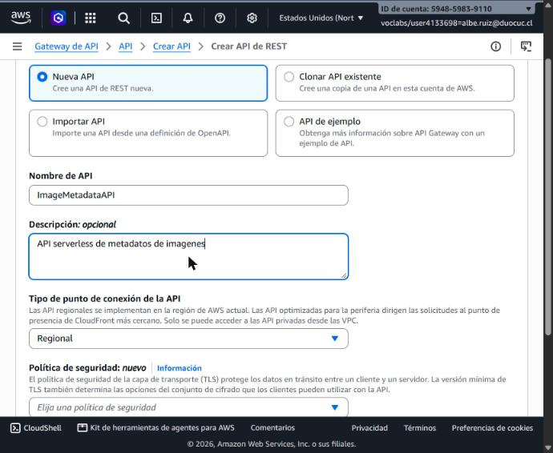 | 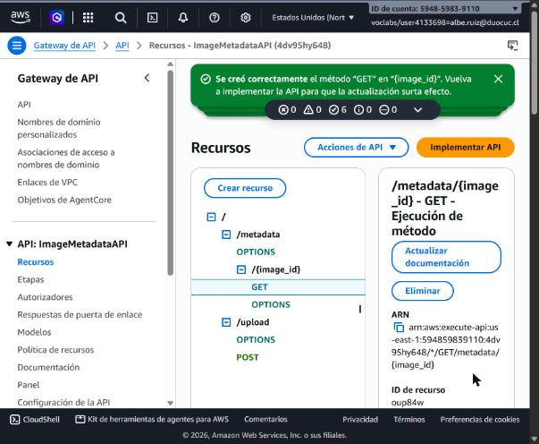 |

| `POST /upload` → `upload_image` (proxy) | `GET /metadata/{image_id}` → `get_image_metadata` (proxy) |
|---|---|
| 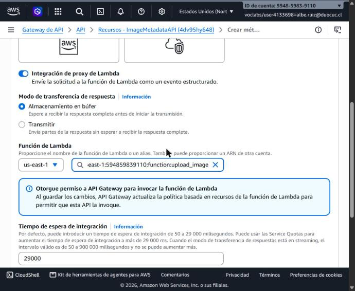 | 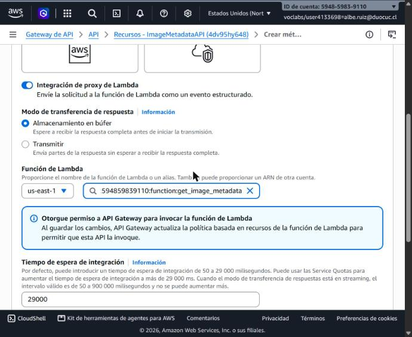 |

| Binary media type `image/jpeg` | CORS en `/upload` (OPTIONS, POST) |
|---|---|
| 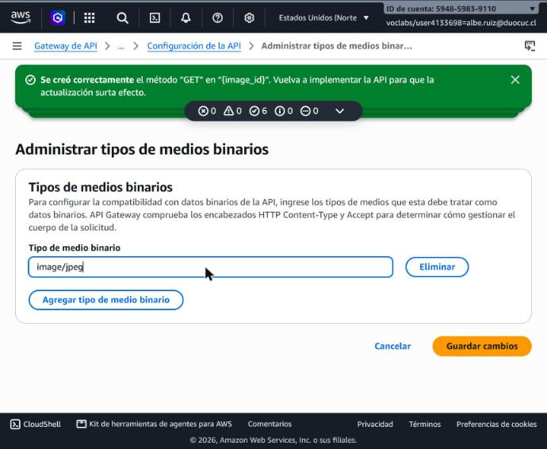 | 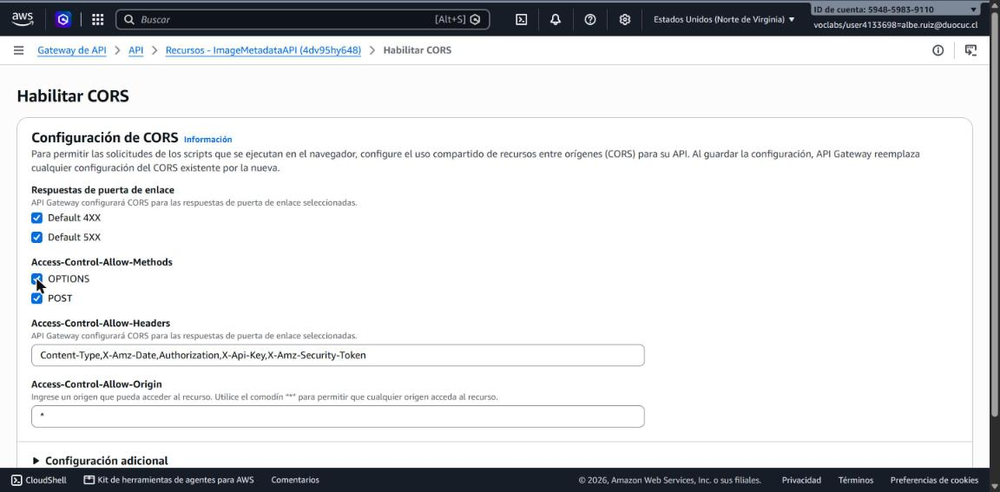 |

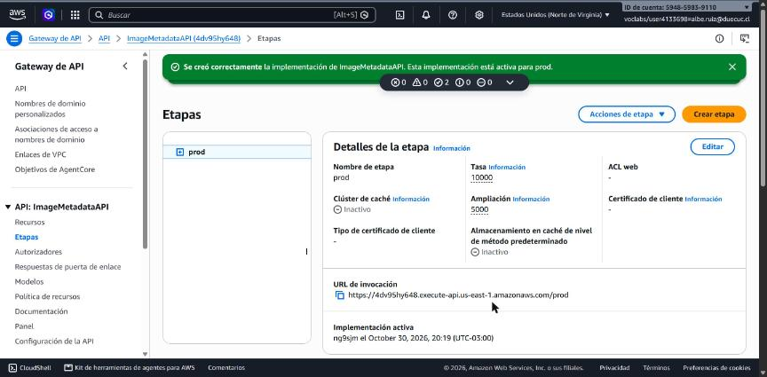

---

## 7. Pruebas con Postman (IE2.3.1)

Se importó la colección [`postman/ImageMetadataAPI.postman_collection.json`](postman), que incluye scripts de test automáticos. Para `POST /upload` se envió un archivo **JPG en *Body → binary*** con `Content-Type: image/jpeg`.

### 7.1 Subir imagen – `POST /upload` → **201 Created**

| Petición con el JPG en binary y respuesta con `image_id` | Tests: 4/4 PASSED |
|---|---|
| 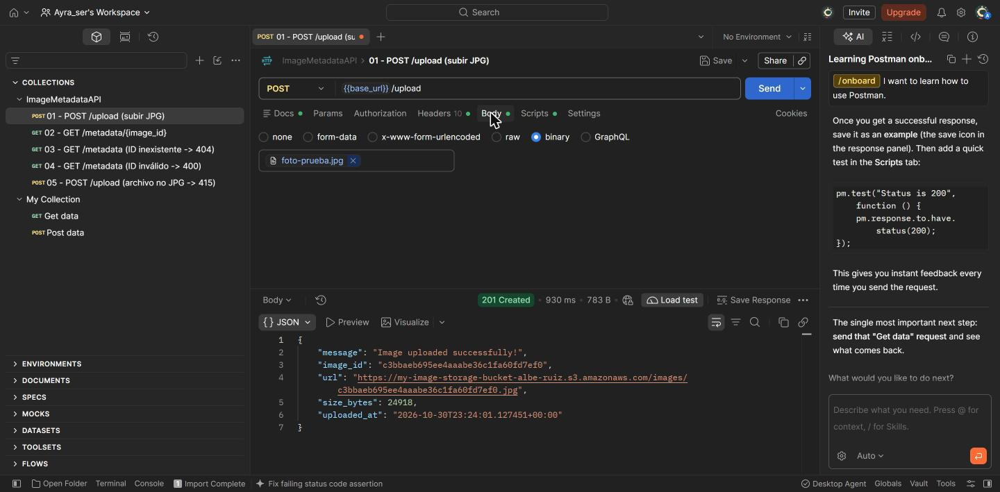 | 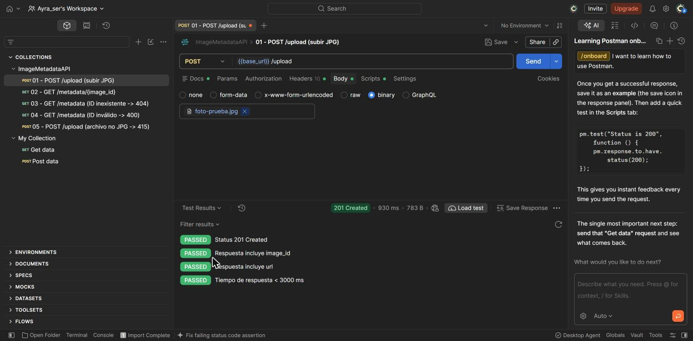 |

### 7.2 Consultar metadatos – `GET /metadata/{image_id}` → **200 OK**

El `image_id` devuelto por el POST (`c3bbaeb695ee4aaabe36c1fa60fd7ef0`) se guarda automáticamente en una variable de la colección y se usa en el GET.

| Respuesta con los metadatos | Tests: 4/4 PASSED |
|---|---|
| 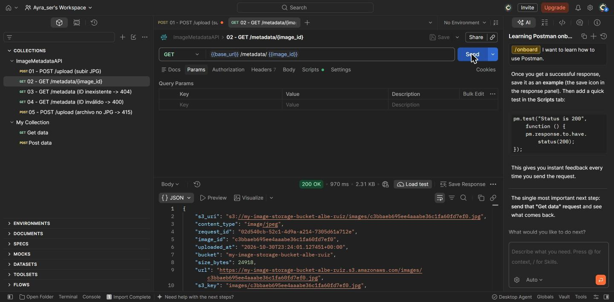 | 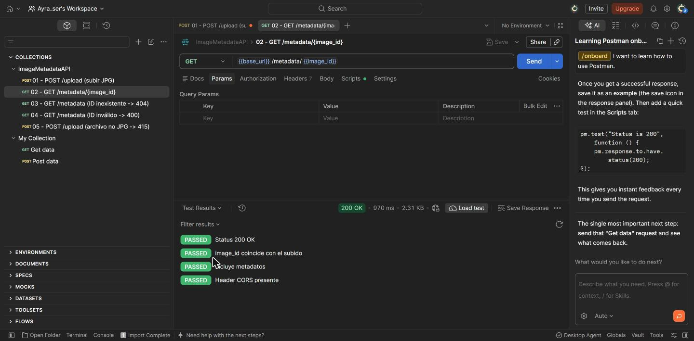 |

### 7.3 Manejo de errores

| ID inexistente → **404** | ID inválido → **400** | Archivo no JPG → **415** |
|---|---|---|
| 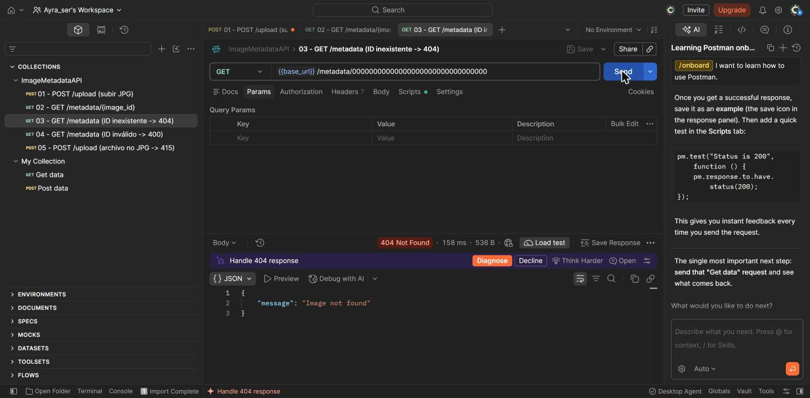 | 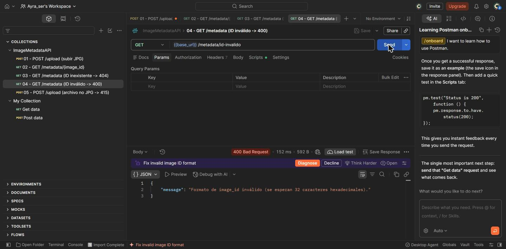 | 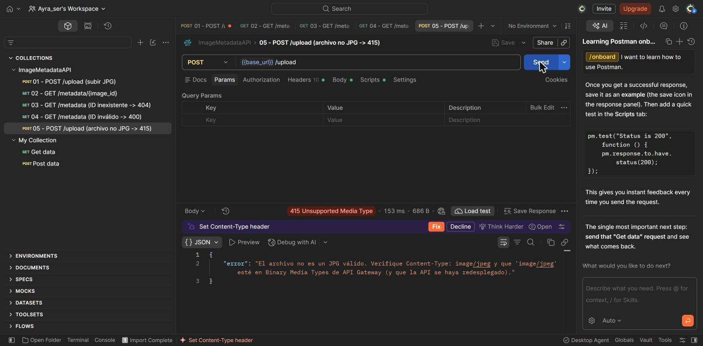 |

### 7.4 Verificación de persistencia

El `size_bytes` que devolvió la API (24 918 bytes) coincide exactamente con el archivo enviado: la imagen llegó íntegra. El objeto quedó en S3, el ítem en DynamoDB y la imagen se abre correctamente desde la URL prefirmada.

| Objeto en S3 (`images/<image_id>.jpg`) | Ítem en DynamoDB |
|---|---|
| 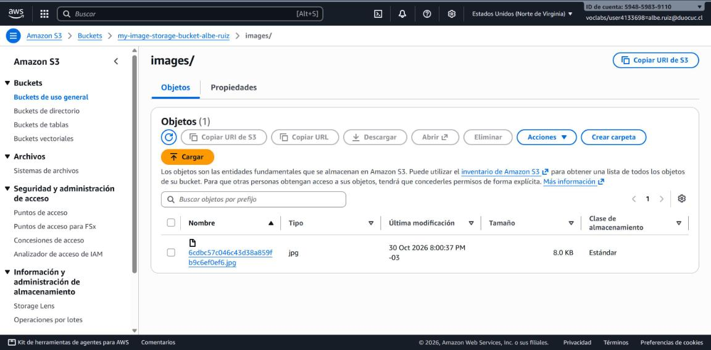 | 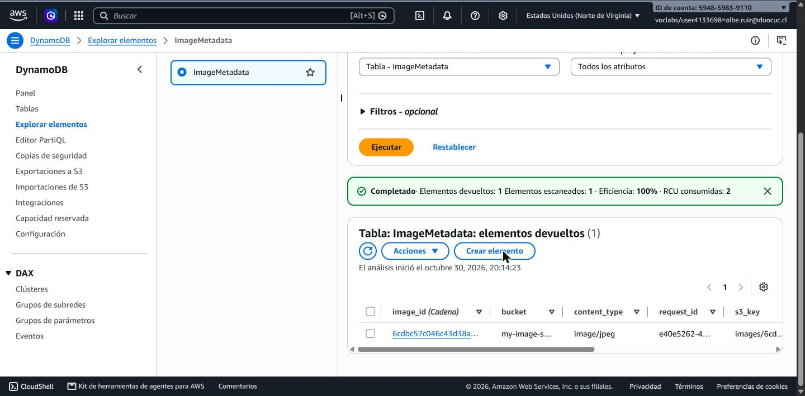 |

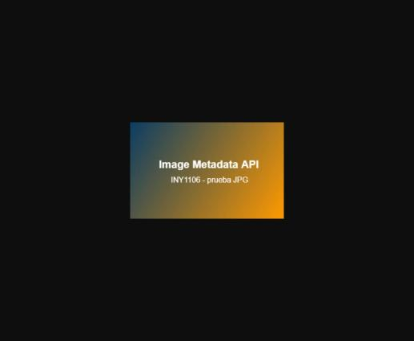

### 7.5 Resumen

| # | Prueba | Esperado | Obtenido | Tiempo |
|---|---|---|---|---|
| 01 | `POST /upload` con JPG | 201 | **201** ✅ | 930 ms |
| 02 | `GET /metadata/{image_id}` | 200 | **200** ✅ | 970 ms |
| 03 | ID inexistente | 404 | **404** ✅ | 158 ms |
| 04 | ID con formato inválido | 400 | **400** ✅ | 152 ms |
| 05 | Archivo que no es JPG | 415 | **415** ✅ | 153 ms |

---

## 8. Troubleshooting, monitoreo y rendimiento (IE2.3.2)

### 8.1 Logs de CloudWatch

Cada función escribe en su grupo de logs `/aws/lambda/<función>`. En el stream de `upload_image` se identifican:
- `INIT_START`: cold start, AWS creó un entorno nuevo.
- `START` / `END`: inicio y fin de cada invocación.
- Logs propios `[INFO]` (solicitud recibida, imagen guardada, metadatos registrados) y `[WARNING]` (archivo inválido).
- La línea `REPORT`, con duración, duración facturada, memoria asignada y memoria usada.

| Stream de logs de `upload_image` | Detalle de la línea `REPORT` |
|---|---|
| 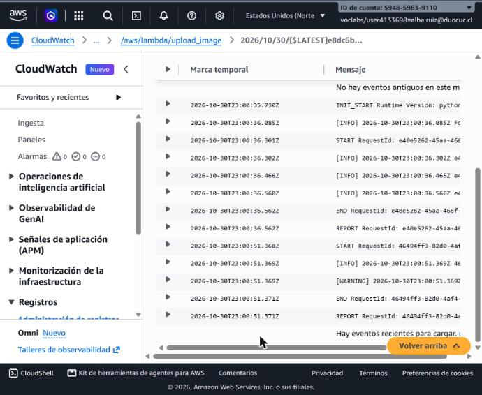 | 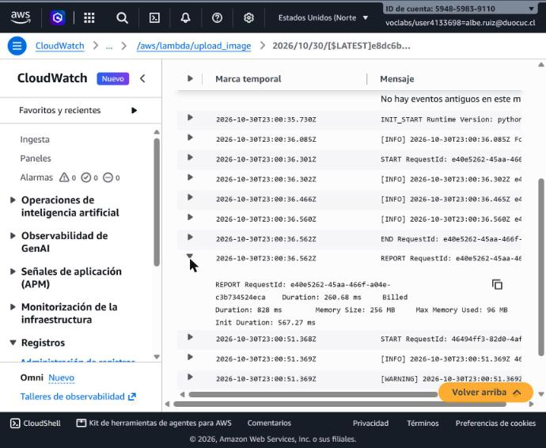 |

**Lectura del `REPORT` de la primera invocación (cold start):**

| Métrica | Valor | Interpretación |
|---|---|---|
| Init Duration | 567,27 ms | Costo del cold start: cargar Python, boto3 y crear los clientes |
| Duration | 260,68 ms | Subir a S3 y escribir en DynamoDB, con las conexiones recién abiertas |
| Memory Size / Max Memory Used | 256 MB / 96 MB | Usa el 37 % de la memoria asignada |
| Invocaciones en caliente | 2,57–2,84 ms | Respuestas 415 sin acceso a S3; el entorno reutiliza los clientes |

### 8.2 Métricas de CloudWatch

En la pestaña *Monitor* de la Lambda se revisaron **Invocations**, **Duration** y **Error count / Success rate**.

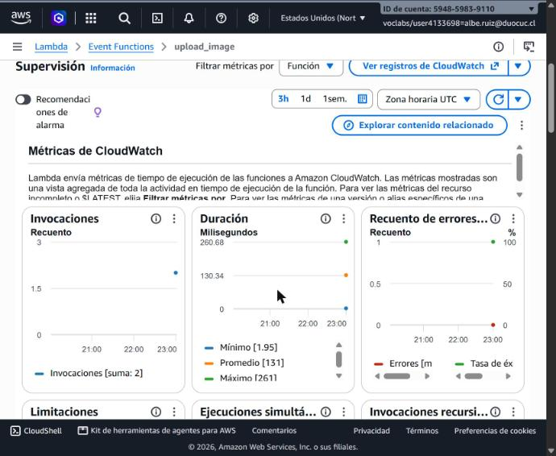

- **Invocations:** cuenta cada petición procesada y coincide con las pruebas realizadas.
- **Duration:** mínimo 1,95 ms, promedio 131 ms y máximo 261 ms. El máximo corresponde al cold start.
- **Errors:** 0 y tasa de éxito 100 %. Los 400/404/415 **no** cuentan como *Errors* porque la función terminó correctamente devolviendo ese código. Solo las excepciones no controladas o los timeouts aparecen en esta métrica.

### 8.3 Casos reales de troubleshooting durante la implementación

**Caso 1 – POST fallaba desde clientes que corren en el navegador (CORS):**
- **Síntoma:** el `GET` funcionaba, pero el `POST` con `Content-Type: image/jpeg` daba *Network Error*.
- **Causa:** la casilla CORS se marcó al crear `/upload` cuando aún no tenía métodos, así que la respuesta al *preflight* (`OPTIONS`) no incluía `POST` en `Access-Control-Allow-Methods`.
- **Solución:** *Habilitar CORS* en `/upload` (OPTIONS y POST) y en `/metadata/{image_id}` (OPTIONS y GET), y volver a **desplegar** en `prod`.

**Caso 2 – `415` al subir un JPG válido desde Postman web:**
- **Síntoma:** Postman respondía `415 Unsupported Media Type` aunque el archivo era JPG.
- **Diagnóstico:** el log `[WARNING]` de CloudWatch mostró que los primeros bytes recibidos eran `efbfbdef`. Es el carácter de reemplazo UTF-8 (`�`), no la firma JPEG `ffd8ff`, así que el archivo llegaba **convertido a texto**.

  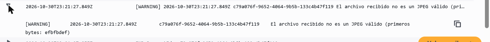

- **Causa:** el *Cloud Agent* de Postman web reenvía el cuerpo binario como texto.
- **Solución:** se instaló el **Postman Desktop Agent**, que envía los bytes originales. Resultado: `201 Created` con `size_bytes` igual al archivo.

**Errores frecuentes y cómo diagnosticarlos:**

| Síntoma | Causa probable | Solución |
|---|---|---|
| `Internal server error` + `Runtime.HandlerNotFound` | Handler distinto al nombre de la función | `lambda_function.upload_image` |
| `Task timed out after 3.00 seconds` | Timeout por defecto | Timeout de 30 s |
| `ResourceNotFoundException` / `NoSuchBucket` | Variable de entorno mal escrita | Revisar `TABLE_NAME` / `BUCKET_NAME` |
| `415` con un JPG | Falta el binary media type o no se redesplegó | `image/jpeg` + *Deploy API* |
| `Missing Authentication Token` | Ruta o stage incorrectos | Usar `/prod/upload` |
| `429` / *Throttles* > 0 | Se superó la concurrencia (máx. 10 en Learner Lab) | Throttling en API Gateway / reserved concurrency |

### 8.4 Cómo personalizar el rendimiento de una Lambda y su efecto en la escalabilidad

1. **Memoria = CPU.** Lambda asigna CPU en proporción a la memoria (128 MB a 10 240 MB; unos 1 769 MB equivalen a 1 vCPU). Con 256 MB la función usa solo 96 MB, pero la mayor parte del tiempo es latencia de red hacia S3 y DynamoDB, que se beneficia de más CPU. Se recomienda medir 256/512/1024 MB y elegir el punto donde la duración deja de bajar. El costo se cobra en GB-segundo, así que menos duración puede compensar la memoria extra.
2. **Timeout ajustado (30 s).** Evita pagar por ejecuciones colgadas. API Gateway corta a los 29 s.
3. **Concurrencia.** Lambda escala creando entornos en paralelo. Concurrencia ≈ solicitudes por segundo × duración, y el **Learner Lab permite como máximo 10**. Con 10 entornos y unos 130 ms de duración, el techo es de unas 75 solicitudes/s. **Reducir la duración aumenta directamente la capacidad.** En producción:
   - *Reserved concurrency* garantiza y limita la capacidad de cada función.
   - *Provisioned concurrency* elimina el cold start de unos 567 ms medido arriba.
4. **Cold starts.** Los clientes `boto3` se crean fuera del handler (ya implementado): por eso las invocaciones en caliente tardan unos 2–3 ms. Otras mejoras: paquete liviano y arquitectura **arm64 (Graviton)**, hasta ~20 % más barata.
5. **Escalabilidad del resto de la arquitectura.**
   - DynamoDB bajo demanda y S3 escalan solos.
   - En API Gateway se puede configurar **throttling** por stage (rate/burst) para proteger el backend, y **caché** para los `GET` repetidos.
   - Para imágenes de más de 6 MB (límite de payload de Lambda) conviene entregar una **URL prefirmada de subida** y que el cliente suba directo a S3.
6. **Monitoreo continuo.** Alarmas de CloudWatch sobre *Errors* ≥ 1, *Throttles* ≥ 1 y *Duration* p95, y un dashboard con las métricas de Lambda y de API Gateway (*Count*, *4XXError*, *5XXError*, *Latency*).

---

## 9. Seguridad

| Control | Implementación |
|---|---|
| Bucket privado | *Block all public access*; acceso solo vía Lambda o URL prefirmada con expiración |
| Cifrado | S3 con SSE-S3; DynamoDB con cifrado administrado por AWS; API solo HTTPS |
| Validación de entrada | Firma JPEG, tamaño máximo y formato del `image_id` |
| Errores | No se exponen trazas al cliente; el detalle queda en CloudWatch |
| Mínimo privilegio | En el Learner Lab se usa `LabRole`, porque no se pueden crear roles. En producción, cada función tendría su propio rol: `s3:PutObject` + `dynamodb:PutItem` para `upload_image`, y `dynamodb:GetItem` + `s3:GetObject` para `get_image_metadata` |
| Mejoras propuestas | API Key + *usage plan*, autorizador Cognito/JWT, AWS WAF, CORS restringido al dominio del frontend |

---

## 10. Conclusiones

Se implementó en AWS una API REST completamente serverless que sube imágenes JPG a S3, guarda sus metadatos en DynamoDB y los consulta por API Gateway. Se usaron los nombres y configuraciones pedidos: `ImageMetadata`/`image_id`, `upload_image` y `get_image_metadata` con timeout de 30 s y `LabRole`, `ImageMetadataAPI` con `POST /upload` y `GET /metadata/{image_id}`.

Las pruebas con Postman confirmaron el flujo completo (201 → 200) y el manejo de errores (400, 404, 415). Con CloudWatch se diagnosticaron dos problemas reales (CORS y la corrupción del binario por el agente de Postman) y se midieron el cold start (567 ms), la duración (131 ms en promedio) y el uso de memoria (96 de 256 MB). A partir de esos datos se proponen ajustes de memoria, concurrencia, throttling y caché para sostener aumentos de demanda sin afectar la experiencia del usuario.
