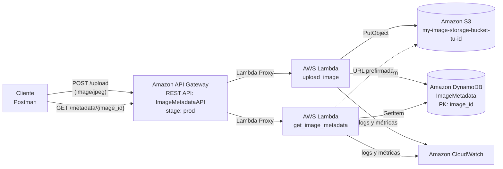

# Image Metadata API – Implementación Serverless en AWS (Consola GUI)

**Asignatura:** INY1106 – Infraestructura de Aplicaciones II
**Evaluación:** Parcial N°2 – Infraestructura Serverless (35 %)
**Estudiante:** _[Nombre Apellido]_  **Fecha:** _[dd/mm/aaaa]_
**Entorno:** AWS Academy Learner Lab – Región `us-east-1` (N. Virginia)
**Rol IAM:** `LabRole` (provisto por el laboratorio)

> **Cómo usar esta guía:** cada paso dice dónde hacer clic. Los bloques **📸 CAPTURA** marcan las evidencias que debes pegar en el informe (PDF o Wiki). Reemplaza siempre `[tu-id]` por tu identificador único (ej. `aruiz2026`). El código completo de las Lambdas está en el **Anexo A**.

---

## Índice

0. [Introducción y arquitectura](#0-introducción-y-arquitectura)
1. [Fase 0 – Preparación del entorno (Learner Lab)](#fase-0--preparación-del-entorno-learner-lab)
2. [Fase 1 – Bucket S3](#fase-1--bucket-s3-ie221--10-)
3. [Fase 2 – Tabla DynamoDB](#fase-2--tabla-dynamodb-ie222--10-)
4. [Fase 3 – Funciones Lambda](#fase-3--funciones-lambda-ie211--30-)
5. [Fase 4 – API Gateway](#fase-4--api-gateway-rest-api-ie223--15-)
6. [Fase 5 – Pruebas con Postman](#fase-5--pruebas-de-funcionamiento-con-postman-ie231--20-)
7. [Fase 6 – Troubleshooting, monitoreo y rendimiento (CloudWatch)](#fase-6--troubleshooting-monitoreo-y-rendimiento-ie232--15-)
8. [Fase 7 – Seguridad aplicada](#fase-7--seguridad-aplicada-il22)
9. [Fase 8 – Armado del informe y checklist de evidencias](#fase-8--armado-del-informe-y-checklist-de-evidencias)
10. [Fase 9 – Demostración en vivo](#fase-9--demostración-en-vivo-ante-la-docente)
11. [Conclusiones](#conclusiones)
12. [Anexo A – Código fuente](#anexo-a--código-fuente)

---

## 0. Introducción y arquitectura

**Objetivo.** Implementar una API REST serverless que permite **subir imágenes JPG** a Amazon S3, **registrar sus metadatos** en Amazon DynamoDB y **consultarlos** por su identificador, sin administrar servidores.

**Indicadores de logro cubiertos**

| Indicador | Dónde se evidencia |
|---|---|
| IL2.1 – Despliega funciones serverless | Fase 3 (Lambdas) |
| IL2.2 – Arquitectura integral con seguridad, backend y persistencia | Fases 1, 2, 4 y 7 |
| IL2.3 – Escalabilidad, monitoreo y optimización | Fases 5 y 6 |

**Diagrama de arquitectura** (diagrama oficial: `v-teacher/INY1106/image_metadata_api/img/image_metadata_api_diagram.png`)



**Flujo**
1. El cliente envía `POST /upload` con la imagen en binario.
2. API Gateway invoca `upload_image`, que valida que sea JPG, genera un `image_id` (UUID de 32 caracteres), guarda el objeto en S3 y registra los metadatos en DynamoDB. Devuelve `201` con el `image_id`.
3. El cliente envía `GET /metadata/{image_id}`. `get_image_metadata` lee DynamoDB y responde con los metadatos y una URL temporal (prefirmada) para ver la imagen.
4. Ambas funciones escriben logs y métricas en CloudWatch.

> 📸 **CAPTURA 0.1** – Pega aquí el diagrama oficial de arquitectura.

---

## Fase 0 – Preparación del entorno (Learner Lab)

1. Ingresa a **AWS Academy** → tu curso → **Modules** → **Launch AWS Academy Learner Lab**.
2. Clic en **Start Lab** y espera a que el círculo junto a "AWS" se ponga **verde** (1–3 min).
3. Clic en **AWS** (verde) → se abre la Consola de Administración en otra pestaña.
4. En la esquina superior derecha verifica que la región sea **N. Virginia (us-east-1)**. Todos los recursos deben crearse ahí.

> ⚠️ **Particularidades del Learner Lab (según el README del laboratorio)**
> - **Entorno persistente:** cuando el temporizador llega a 0:00 la sesión termina, pero los recursos **se conservan**. Puedes renovar el tiempo pulsando *Start Lab* otra vez antes de que llegue a cero.
> - **Regiones permitidas:** solo `us-east-1` y `us-west-2`. Este proyecto usa `us-east-1`.
> - **IAM muy limitado:** no puedes crear usuarios ni roles. Usa siempre **`LabRole`**: el README indica adjuntarlo a las Lambdas que necesiten acceder a otros servicios, y API Gateway, S3, DynamoDB y SNS pueden asumirlo.
> - **Lambda: máximo 10 entornos de ejecución concurrentes** en la cuenta. Superar un límite de servicio puede **desactivar la cuenta y borrar todos los recursos**, así que no hagas pruebas de carga en paralelo.
> - **Presupuesto:** revísalo en la parte superior del lab (se actualiza cada 8–12 h). Si se agota, la cuenta se deshabilita y se pierde todo. Esta arquitectura serverless prácticamente no consume presupuesto porque no tiene recursos encendidos permanentemente.
> - **No uses *Reset*:** borra permanentemente todo lo creado en la cuenta.
> - La cuenta ya trae **dos funciones Lambda creadas por el laboratorio**. No las modifiques ni las borres.
> - **No muestres el panel *AWS Details*** en capturas: contiene credenciales y llaves.

> 📸 **CAPTURA 0.2** – Learner Lab con estado verde y consola en `us-east-1`.

---

## Fase 1 – Bucket S3 (IE2.2.1 – 10 %)

### 1.1 Crear el bucket
1. En la barra de búsqueda superior escribe **S3** → clic en **S3**.
2. Clic en **Create bucket**.
3. **General configuration**
   - **AWS Region:** `US East (N. Virginia) us-east-1`
   - **Bucket type:** `General purpose`
   - **Bucket name:** `my-image-storage-bucket-[tu-id]` (solo minúsculas, números y guiones; único a nivel mundial).
4. **Object Ownership:** `ACLs disabled (recommended)`.
5. **Block Public Access settings for this bucket:** ✅ **Block *all* public access** (las 4 opciones marcadas).
   *Justificación:* las imágenes no se exponen públicamente; se accede a ellas solo mediante la Lambda o URLs prefirmadas temporales.
6. **Bucket Versioning:** `Disable` (opcional `Enable` si se quiere proteger contra sobrescrituras/borrados; genera costo adicional).
7. **Tags** (recomendado): `Proyecto = ImageMetadataAPI`.
8. **Default encryption:** `Server-side encryption with Amazon S3 managed keys (SSE-S3)` y **Bucket Key:** `Enable`.
9. **Advanced settings → Object Lock:** `Disable`.
10. Clic en **Create bucket**.

> 📸 **CAPTURA 1.1** – Formulario con nombre y región antes de crear.
> 📸 **CAPTURA 1.2** – Sección *Block Public Access* con todo bloqueado.

### 1.2 Permisos mínimos necesarios
- **No se requiere bucket policy para que la Lambda escriba**: el acceso lo otorga la política IAM del rol `LabRole` asignado a la función.
- **Recomendado (seguridad extra):** forzar HTTPS. En el bucket → pestaña **Permissions** → **Bucket policy** → **Edit** → pega (cambiando el nombre del bucket) → **Save changes**:

```json
{
  "Version": "2012-10-17",
  "Statement": [
    {
      "Sid": "DenyInsecureTransport",
      "Effect": "Deny",
      "Principal": "*",
      "Action": "s3:*",
      "Resource": [
        "arn:aws:s3:::my-image-storage-bucket-[tu-id]",
        "arn:aws:s3:::my-image-storage-bucket-[tu-id]/*"
      ],
      "Condition": { "Bool": { "aws:SecureTransport": "false" } }
    }
  ]
}
```

> 📸 **CAPTURA 1.3** – Lista de buckets con el bucket creado (columna *Region* = us-east-1).
> 📸 **CAPTURA 1.4** – Pestaña *Properties* mostrando *Default encryption* SSE-S3 (y *Permissions* con la bucket policy si la aplicaste).

---

## Fase 2 – Tabla DynamoDB (IE2.2.2 – 10 %)

1. Busca **DynamoDB** → menú izquierdo **Tables** → **Create table**.
2. **Table details**
   - **Table name:** `ImageMetadata` (respeta mayúsculas).
   - **Partition key:** `image_id` – tipo **String**.
   - **Sort key:** dejar vacío.
3. **Table settings:** selecciona **Customize settings**.
   - **Table class:** `DynamoDB Standard`.
   - **Read/write capacity settings → Capacity mode:** **On-demand** (pago por solicitud; escala automáticamente sin planificar capacidad).
   - **Secondary indexes:** ninguno.
   - **Encryption at rest:** `Owned by Amazon DynamoDB`.
   - **Deletion protection:** opcional (activarlo evita borrados accidentales).
   - **Tags:** `Proyecto = ImageMetadataAPI`.
4. Clic en **Create table** y espera a que **Status = Active**.

> 📸 **CAPTURA 2.1** – Formulario con nombre de tabla y partition key `image_id (String)`.
> 📸 **CAPTURA 2.2** – Tabla en estado **Active**, pestaña *Overview* (se ve *Partition key* y *Capacity mode: On-demand*).

---

## Fase 3 – Funciones Lambda (IE2.1.1 – 30 %)

> Este indicador es el de **mayor peso**. Se evalúan: código, variables de entorno y timeout de **ambas** funciones.

### 3.1 Función `upload_image`

**a) Crear la función**
1. Busca **Lambda** → **Create function**.
2. Selecciona **Author from scratch**.
3. **Function name:** `upload_image`
4. **Runtime:** `Python 3.13` (o la versión Python 3.x más reciente disponible).
5. **Architecture:** `x86_64` (ver Fase 6 sobre `arm64`).
6. **Permissions** → despliega **Change default execution role** → **Use an existing role** → **Existing role:** `LabRole`.
7. Clic en **Create function**.

> 📸 **CAPTURA 3.1** – Formulario con nombre, runtime y rol `LabRole`.

**b) Pegar el código**
1. Pestaña **Code** → abre `lambda_function.py`.
2. Borra el contenido y pega el código de **Anexo A.1**.
3. Clic en **Deploy** (espera el mensaje *Successfully updated the function upload_image*).

**c) Configurar el handler**
El código define la función `upload_image(event, context)`. En la misma pestaña **Code**, baja a **Runtime settings** → **Edit** → **Handler:** `lambda_function.upload_image` → **Save**.
*(El código incluye también el alias `lambda_handler`, por lo que funciona aunque dejes el handler por defecto; igualmente configúralo para que coincida con la pauta.)*

**d) Timeout (30 s)**
Pestaña **Configuration** → **General configuration** → **Edit**:
- **Memory:** `256 MB` (ver análisis en Fase 6; el mínimo 128 MB también funciona).
- **Timeout:** `0 min 30 sec`.
- **Execution role:** confirmar `LabRole`.
- **Save**.

**e) Variables de entorno**
**Configuration** → **Environment variables** → **Edit** → **Add environment variable**:

| Key | Value |
|---|---|
| `BUCKET_NAME` | `my-image-storage-bucket-[tu-id]` |
| `TABLE_NAME` | `ImageMetadata` |

**Save**.

**f) Prueba unitaria en la consola**
Pestaña **Test** → **Create new event** → nombre `jpg-minimo` → pega:

```json
{
  "body": "/9j/4AAQSkZJRgABAQAAAQABAAD/2Q==",
  "isBase64Encoded": true
}
```

Clic en **Test**. Resultado esperado: `"statusCode": 201` y un `image_id` en el `body`. *(Es un JPEG mínimo válido de 22 bytes, solo para probar el flujo.)*

> 📸 **CAPTURA 3.2** – *General configuration* con Timeout 30 s y rol `LabRole`.
> 📸 **CAPTURA 3.3** – *Environment variables* con `BUCKET_NAME` y `TABLE_NAME`.
> 📸 **CAPTURA 3.4** – Código desplegado en el editor + *Runtime settings* con el handler.
> 📸 **CAPTURA 3.5** – Resultado del *Test* con `statusCode 201`.

### 3.2 Función `get_image_metadata`

Repite el mismo procedimiento con estas diferencias:

| Parámetro | Valor |
|---|---|
| Function name | `get_image_metadata` |
| Runtime / Rol | Python 3.13 / `LabRole` |
| Código | **Anexo A.2** (pegar en `lambda_function.py` → **Deploy**) |
| Handler | `lambda_function.get_image_metadata` |
| Timeout / Memoria | `30 sec` / `256 MB` |
| Variables de entorno | `TABLE_NAME = ImageMetadata` |

**Prueba en consola:** evento `consulta` con el `image_id` obtenido en la prueba 3.1-f:

```json
{
  "pathParameters": { "image_id": "PEGAR_AQUI_EL_IMAGE_ID" }
}
```

Resultado esperado: `statusCode 200` con los metadatos y `download_url`.

> 📸 **CAPTURA 3.6** – *General configuration* (Timeout 30 s, `LabRole`).
> 📸 **CAPTURA 3.7** – *Environment variables* con `TABLE_NAME`.
> 📸 **CAPTURA 3.8** – Código desplegado + handler.
> 📸 **CAPTURA 3.9** – Resultado del *Test* con `statusCode 200`.

### 3.3 Mejoras respecto al código base del profesor
Explica brevemente en el informe por qué el código fue optimizado:

| Problema en el código base | Solución aplicada |
|---|---|
| La respuesta del upload **no devolvía el `image_id`**, necesario para el GET | Se devuelve `image_id` en el JSON de respuesta |
| El cuerpo binario (base64) se guardaba sin decodificar → imagen corrupta en S3 | Decodifica base64 cuando `isBase64Encoded = true` |
| No validaba el tipo de archivo | Valida la firma JPEG (`FF D8 FF`) → `415` si no es JPG |
| `event.get('pathParameters', {})` falla si llega `None` | Usa `(event.get('pathParameters') or {})` |
| Sin cabeceras CORS ni `Content-Type` | Respuestas con CORS y `application/json` |
| Todos los errores devolvían 500 | Códigos HTTP correctos: 400, 404, 413, 415, 500, 502 |
| `print()` sin contexto | `logging` estructurado con `request_id` (útil en CloudWatch) |
| El nombre de función no coincide con el handler por defecto | Handler documentado + alias `lambda_handler` |
| La URL pública de S3 no funciona con el bucket privado | GET entrega una **URL prefirmada** temporal (1 h) |

---

## Fase 4 – API Gateway (REST API) (IE2.2.3 – 15 %)

### 4.1 Crear la API
1. Busca **API Gateway** → **Create API**.
2. En **REST API** (no la "private") → **Build**.
3. **New API** → **API name:** `ImageMetadataAPI` → **Description:** `API serverless de metadatos de imágenes` → **API endpoint type:** `Regional` → **Create API**.

### 4.2 Recurso `/upload` con método `POST`
1. Con `/` seleccionado → **Create resource**.
   - **Resource path:** `/` – **Resource name:** `upload`
   - ✅ **CORS (Cross Origin Resource Sharing)** → **Create resource**.
2. Selecciona `/upload` → **Create method**.
   - **Method type:** `POST`
   - **Integration type:** `Lambda function`
   - ✅ **Lambda proxy integration** (activado)
   - **Lambda function:** región `us-east-1` → selecciona `upload_image`
   - **Integration timeout:** dejar `29000` ms
   - **Create method**.
   La consola agrega automáticamente el permiso para que API Gateway invoque la Lambda (lo verás en Lambda → *Configuration* → *Permissions* → *Resource-based policy statements*).

### 4.3 Recurso `/metadata/{image_id}` con método `GET`
1. Selecciona `/` → **Create resource** → **Resource name:** `metadata` → ✅ CORS → **Create resource**.
2. Selecciona `/metadata` → **Create resource** → **Resource path:** `/metadata/` → **Resource name:** `{image_id}` (con llaves: así se define el **parámetro de ruta**) → ✅ CORS → **Create resource**.
3. Selecciona `/metadata/{image_id}` → **Create method**:
   - **Method type:** `GET` – **Integration type:** `Lambda function` – ✅ **Lambda proxy integration** – **Lambda function:** `get_image_metadata` → **Create method**.

### 4.4 Habilitar CORS
Si marcaste la casilla CORS al crear cada recurso, ya existe un método `OPTIONS`. Para completar/confirmar:
1. Selecciona `/upload` → **Enable CORS** → marca `POST` y `OPTIONS` → **Access-Control-Allow-Origin:** `*` → **Save**.
2. Repite en `/metadata/{image_id}` marcando `GET` y `OPTIONS`.

> Con integración **proxy**, las cabeceras CORS de las respuestas reales las entrega la Lambda (ya están en el código). El `OPTIONS` resuelve el *preflight* del navegador.

### 4.5 ⚠️ Binary media types (imprescindible para subir JPG)
Sin esto API Gateway trata la imagen como texto y la **corrompe**.
1. Menú izquierdo → **API settings** → **Binary media types** → **Manage media types**.
2. **Add binary media type:** `image/jpeg` → **Save changes**.

### 4.6 Desplegar la API (stage `prod`)
1. Vuelve a **Resources** → **Deploy API**.
2. **Stage:** `*New stage*` → **Stage name:** `prod` → **Description:** `Producción` → **Deploy**.
3. En **Stages → prod** copia la **Invoke URL**:
   `https://<api-id>.execute-api.us-east-1.amazonaws.com/prod`

> 🔁 Cada vez que cambies recursos, métodos o *Binary media types* debes hacer **Deploy API** de nuevo sobre `prod`.

### 4.7 Prueba desde la consola (opcional, buena evidencia)
Selecciona `GET` en `/metadata/{image_id}` → pestaña **Test** → **Path → image_id:** el ID de la Fase 3 → **Test** → debe responder `200`.

> 📸 **CAPTURA 4.1** – Árbol de recursos completo (`/upload POST, OPTIONS` y `/metadata/{image_id} GET, OPTIONS`).
> 📸 **CAPTURA 4.2** – *Method execution* de `POST /upload` mostrando *Integration type: Lambda proxy* → `upload_image`.
> 📸 **CAPTURA 4.3** – *Method execution* de `GET /metadata/{image_id}` → `get_image_metadata`.
> 📸 **CAPTURA 4.4** – *API settings* con `image/jpeg` en Binary media types.
> 📸 **CAPTURA 4.5** – Stage `prod` con la **Invoke URL** visible.

---

## Fase 5 – Pruebas de funcionamiento con Postman (IE2.3.1 – 20 %)

### 5.1 Preparación
1. Abre Postman → **Import** → selecciona el archivo `postman/ImageMetadataAPI.postman_collection.json` (entregado junto a esta guía).
2. Clic en la colección → pestaña **Variables** → en `base_url` pega tu **Invoke URL** (sin `/` final) → **Save**.

*(Si prefieres crearla a mano, sigue 5.2 y 5.3.)*

### 5.2 `POST /upload` – subir una imagen JPG
1. **Método:** `POST` – **URL:** `{{base_url}}/upload`
2. Pestaña **Headers:** `Content-Type: image/jpeg`
3. Pestaña **Body** → **binary** → **Select File** → elige un `.jpg` (menor a 5 MB).
4. **Send**.

Respuesta esperada (`201 Created`):
```json
{
  "message": "Image uploaded successfully!",
  "image_id": "3f2b9c0e8a7d4e51b6c2a9f0d1e3b4c5",
  "url": "https://my-image-storage-bucket-[tu-id].s3.amazonaws.com/images/3f2b9c0e8a7d4e51b6c2a9f0d1e3b4c5.jpg",
  "size_bytes": 84512,
  "uploaded_at": "2026-10-30T15:42:10.123456+00:00"
}
```
La pestaña **Test Results** debe mostrar todos los tests en verde y el `image_id` queda guardado automáticamente en la variable de colección.

> **¿Por qué *binary* y no *form-data*?** Con *form-data* el cuerpo llega como `multipart/form-data` (con delimitadores y cabeceras); la Lambda guardaría ese sobre completo y no un JPG puro. *Binary* envía exactamente los bytes de la imagen, que es lo que espera la API.

### 5.3 `GET /metadata/{image_id}` – consultar metadatos
1. **Método:** `GET` – **URL:** `{{base_url}}/metadata/{{image_id}}` (o pega el ID manualmente).
2. **Send**.

Respuesta esperada (`200 OK`):
```json
{
  "image_id": "3f2b9c0e8a7d4e51b6c2a9f0d1e3b4c5",
  "bucket": "my-image-storage-bucket-[tu-id]",
  "s3_key": "images/3f2b9c0e8a7d4e51b6c2a9f0d1e3b4c5.jpg",
  "s3_uri": "s3://my-image-storage-bucket-[tu-id]/images/3f2b9c0e8a7d4e51b6c2a9f0d1e3b4c5.jpg",
  "url": "https://my-image-storage-bucket-[tu-id].s3.amazonaws.com/images/3f2b9c0e8a7d4e51b6c2a9f0d1e3b4c5.jpg",
  "content_type": "image/jpeg",
  "size_bytes": 84512,
  "uploaded_at": "2026-10-30T15:42:10.123456+00:00",
  "request_id": "c1d2e3f4-...",
  "download_url": "https://my-image-storage-bucket-[tu-id].s3.amazonaws.com/images/...?X-Amz-Signature=...",
  "download_url_expires_in": 3600
}
```
Abre `download_url` en el navegador: debe mostrarse tu imagen (demuestra que se guardó sin corromperse). La `url` directa responde *AccessDenied*, lo que **confirma que el bucket es privado**.

### 5.4 Pruebas negativas (manejo de errores)
| Prueba | Petición | Resultado esperado |
|---|---|---|
| ID inexistente | `GET /metadata/00000000000000000000000000000000` | `404 Image not found` |
| ID con formato inválido | `GET /metadata/id-invalido` | `400` |
| Archivo que no es JPG | `POST /upload` con texto plano | `415` |

### 5.5 Verificación en la consola (persistencia)
1. **S3** → tu bucket → carpeta `images/` → se ve el objeto `<image_id>.jpg` con su tamaño.
2. **DynamoDB** → **Explore items** → tabla `ImageMetadata` → se ve el ítem con el mismo `image_id`.

> 📸 **CAPTURA 5.1** – Postman `POST /upload`: Body binary, status `201` y respuesta con `image_id`.
> 📸 **CAPTURA 5.2** – Postman `GET /metadata/{image_id}`: status `200` y JSON de metadatos.
> 📸 **CAPTURA 5.3** – *Test Results* en verde (o el *Collection Runner* con las 5 peticiones).
> 📸 **CAPTURA 5.4** – Pruebas negativas (404 / 400 / 415).
> 📸 **CAPTURA 5.5** – Objeto en S3. 📸 **CAPTURA 5.6** – Ítem en DynamoDB *Explore items*.
> 📸 **CAPTURA 5.7** – Imagen abierta desde `download_url`.

**Alternativa por terminal (curl).** Puedes usar **AWS CloudShell** (ícono de terminal en la barra superior de la consola, ya incluido en el Learner Lab) o tu equipo. En CloudShell sube la imagen con *Actions → Upload file*:
```bash
curl -X POST "$BASE_URL/upload" -H "Content-Type: image/jpeg" --data-binary @foto.jpg
```
```bash
curl "$BASE_URL/metadata/<image_id>"
```

---

## Fase 6 – Troubleshooting, monitoreo y rendimiento (IE2.3.2 – 15 %)

> Para tener datos útiles, ejecuta antes el *Collection Runner* de Postman con **10–20 iteraciones** (genera invocaciones, algunas con error controlado 400/404/415). El Runner envía las peticiones **una tras otra**, así que la concurrencia se mantiene en 1 y respeta el límite de 10 del Learner Lab. **No uses herramientas de carga en paralelo** (JMeter, k6, Runner con muchos hilos).

### 6.1 Logs de CloudWatch
1. **Lambda** → `upload_image` → pestaña **Monitor** → **View CloudWatch logs**.
   (o **CloudWatch** → **Logs** → **Log groups** → `/aws/lambda/upload_image`)
2. Abre el **log stream** más reciente. Interpreta las líneas:

| Línea | Significado |
|---|---|
| `INIT_START` / `Init Duration` | **Cold start**: AWS creó un contenedor nuevo y ejecutó el código fuera del handler |
| `START RequestId: ...` | Inicio de una invocación |
| `[INFO] Imagen guardada en s3://...` | Log propio de la aplicación |
| `[WARNING]` / `[ERROR]` | Errores controlados / excepciones con traza |
| `END RequestId` | Fin de la invocación |
| `REPORT ... Duration / Billed Duration / Memory Size / Max Memory Used` | Tiempo real, tiempo facturado, memoria asignada vs. usada |

3. Repite para `/aws/lambda/get_image_metadata`.

**CloudWatch Logs Insights** (CloudWatch → **Logs Insights** → selecciona ambos log groups → pega la consulta → **Run query**):

```
filter @type = "REPORT"
| stats count(*) as invocaciones,
        avg(@duration) as duracion_prom_ms,
        max(@duration) as duracion_max_ms,
        max(@maxMemoryUsed / 1000 / 1000) as memoria_max_mb,
        avg(@memorySize / 1000 / 1000) as memoria_asignada_mb
  by @log
```

```
fields @timestamp, @message
| filter @message like /ERROR|WARNING/
| sort @timestamp desc
| limit 20
```

```
filter @type = "REPORT" and ispresent(@initDuration)
| stats count(*) as cold_starts, avg(@initDuration) as init_prom_ms by @log
```

> 📸 **CAPTURA 6.1** – Log stream de `upload_image` con `START`, logs propios y `REPORT`.
> 📸 **CAPTURA 6.2** – Log de un error controlado (ej. 415 o 404) identificado en CloudWatch.
> 📸 **CAPTURA 6.3** – Resultado de las consultas de Logs Insights.

### 6.2 Métricas de CloudWatch
1. **Lambda** → función → **Monitor** → **Metrics**. Analiza:
   - **Invocations** – número de ejecuciones (debe coincidir con las pruebas realizadas).
   - **Duration** – promedio/máximo en ms (los picos corresponden a cold starts).
   - **Error count and success rate** – errores no controlados (excepciones). *Nota:* los 400/404/415 **no** cuentan como *Errors* porque la función terminó correctamente devolviendo ese código.
   - **Throttles** – invocaciones rechazadas por límite de concurrencia (debería ser 0).
   - **Concurrent executions** – ejecuciones simultáneas.
2. **API Gateway** → `ImageMetadataAPI` → **Dashboard** (o CloudWatch → Metrics → ApiGateway): **Count**, **4XXError**, **5XXError**, **Latency** e **IntegrationLatency** (la diferencia entre ambas es el *overhead* de API Gateway).
3. (Opcional, suma puntos) **CloudWatch** → **Dashboards** → **Create dashboard** `ImageMetadataAPI-Dashboard` con widgets de *Invocations*, *Errors*, *Duration* de ambas Lambdas y *5XXError* de la API.
4. (Opcional) **Alarms** → **Create alarm** → métrica `Lambda > By Function Name > upload_image > Errors` → *Static, Greater/Equal 1*, período 5 min → notificación a un tópico SNS nuevo con tu correo (SNS está habilitado en el Learner Lab; confirma la suscripción desde el email). Una segunda alarma útil es sobre **Throttles ≥ 1**, que avisa si se alcanzó el límite de concurrencia.

> 📸 **CAPTURA 6.4** – Pestaña *Monitor* de `upload_image` (Invocations, Duration, Errors).
> 📸 **CAPTURA 6.5** – Pestaña *Monitor* de `get_image_metadata`.
> 📸 **CAPTURA 6.6** – Métricas de API Gateway (Count, 4XX, Latency).
> 📸 **CAPTURA 6.7** – Dashboard / alarma (si lo hiciste).

### 6.3 Troubleshooting – errores frecuentes y cómo diagnosticarlos

| Síntoma | Dónde se ve | Causa probable | Solución |
|---|---|---|---|
| `{"message":"Internal server error"}` + log `Runtime.HandlerNotFound` | Postman + CloudWatch | Handler no coincide con el nombre de la función | *Runtime settings → Handler* = `lambda_function.upload_image` |
| `Task timed out after 3.00 seconds` | CloudWatch | No se ajustó el timeout | *General configuration → Timeout* = 30 s |
| `500 Configuración incompleta` / `KeyError` | Postman + CloudWatch | Faltan variables de entorno | Revisar `BUCKET_NAME` y `TABLE_NAME` |
| `502 ... NoSuchBucket` / `AccessDenied` | CloudWatch | Nombre de bucket mal escrito o rol incorrecto | Corregir variable / usar `LabRole` |
| `ResourceNotFoundException` | CloudWatch | Nombre de tabla incorrecto o en otra región | `TABLE_NAME = ImageMetadata`, región `us-east-1` |
| `415` aunque envío un JPG | Postman | Falta `image/jpeg` en *Binary media types* o no se redesplegó | Fase 4.5 + **Deploy API** |
| `{"message":"Missing Authentication Token"}` (403) | Postman | Ruta o stage incorrecto, o API no desplegada | Verificar URL `/prod/upload` y redesplegar |
| `502 Malformed Lambda proxy response` | Postman | La Lambda no devuelve `statusCode`/`body` string | Usar el código del Anexo A |
| Error CORS en navegador | Consola del navegador | Falta `OPTIONS` o cabeceras CORS | Fase 4.4 y cabeceras en la Lambda |
| Credenciales expiradas / consola cerrada | Consola AWS | El temporizador del lab llegó a 0:00 | *Start Lab* nuevamente (los recursos se conservan) |
| `429 Too Many Requests` / métrica *Throttles* > 0 | Postman + CloudWatch | Se superaron los 10 entornos concurrentes del lab | Bajar la carga paralela; en producción, reserved concurrency + throttling de API Gateway |
| Error de acceso al abrir un servicio | Consola AWS | Región distinta de `us-east-1`/`us-west-2` | Cambiar a `us-east-1` |

**Evidencia de troubleshooting (recomendado):** provoca un error a propósito, documenta el diagnóstico y la corrección. Ejemplo:
1. Cambia temporalmente `TABLE_NAME` a `ImageMetadataX` en `upload_image`.
2. Envía `POST /upload` → respuesta `502 ResourceNotFoundException`.
3. Muestra el log del error en CloudWatch, explica la causa y restaura el valor correcto.
4. Repite la prueba → `201`.

> 📸 **CAPTURA 6.8** – Error provocado (Postman + log) y prueba exitosa tras corregir.

### 6.4 Personalización del rendimiento y optimización

**a) Memoria = CPU.** En Lambda la CPU se asigna proporcionalmente a la memoria (128 MB a 10 240 MB; ~1 769 MB equivale a 1 vCPU completa). Más memoria puede **reducir la duración** y, como el costo es *GB-segundo*, a veces cuesta lo mismo o menos.

**Experimento sugerido** (completa la tabla con tus datos del `REPORT`):

| Memoria | Duración prom. (ms) | Max Memory Used (MB) | Cold start Init (ms) | Observación |
|---|---|---|---|---|
| 128 MB | | | | |
| 256 MB | | | | |
| 512 MB | | | | |
| 1024 MB | | | | |

Procedimiento: cambia *Memory* en *General configuration*, ejecuta 10 iteraciones del Runner y toma el promedio con Logs Insights. Elige el valor donde la duración deja de mejorar significativamente (punto óptimo costo/rendimiento). La herramienta **AWS Lambda Power Tuning** automatiza este análisis (puede no estar disponible en el Learner Lab; menciónala como mejora).

**b) Timeout.** 30 s cubre la subida a S3; un timeout ajustado evita pagar por ejecuciones colgadas. API Gateway corta a los 29 s de todas formas.

**c) Concurrencia y escalabilidad automática.**
- Lambda escala horizontalmente creando entornos de ejecución en paralelo cuando sube la demanda. Concurrencia ≈ solicitudes por segundo × duración promedio en segundos.
- **En este Learner Lab el máximo es 10 entornos concurrentes** (en una cuenta normal la cuota típica es 1 000). Ejemplo: con 10 de concurrencia y una duración de 200 ms, el techo teórico es ~50 solicitudes/s. Si la duración baja a 100 ms (por ejemplo, con más memoria), el techo sube a ~100 solicitudes/s. **Optimizar la duración aumenta directamente la capacidad.** Las solicitudes por encima del límite aparecen en la métrica *Throttles* y API Gateway responde `429/5XX`.
- **Reserved concurrency:** garantiza capacidad a una función crítica y al mismo tiempo limita su máximo, lo que protege a DynamoDB y los costos ante picos. En el lab, con un tope de 10, AWS normalmente no permite reservar (exige dejar un mínimo sin reservar), así que descríbela como recomendación para producción.
- **Provisioned concurrency:** mantiene entornos pre-inicializados y elimina los cold starts en horarios de alta demanda. Tiene costo y, por el mismo límite, no es aplicable en el lab: menciónala como mejora.
- **Throttling de API Gateway** (punto e): con un *Rate* y *Burst* menores que la capacidad de las Lambdas, el exceso se rechaza en la puerta con `429` antes de saturar el backend.

**d) Reducir cold starts y latencia.**
- Clientes `boto3` creados **fuera del handler** (ya implementado): se reutilizan entre invocaciones.
- Paquete pequeño y pocas dependencias.
- Arquitectura **arm64 (Graviton)**: hasta ~20 % menor costo por GB-s con rendimiento similar o mejor.

**e) Capas de servicio que también escalan.**
- **DynamoDB On-Demand:** se adapta automáticamente al tráfico sin planificar RCU/WCU.
- **S3:** escala prácticamente sin límite.
- **API Gateway:** *throttling* por stage (*Stages → prod → Edit → Throttling*: *Rate* y *Burst*) para proteger el backend; **caché** de stage para el `GET` repetido (reduce invocaciones de Lambda).
- **Imágenes grandes:** el payload de Lambda está limitado a 6 MB; para archivos mayores conviene que la API entregue una **URL prefirmada de subida** y el cliente suba directo a S3 (Lambda no procesa los bytes → menor costo y latencia).

**f) Observabilidad continua.** Alarmas sobre *Errors*, *Throttles* y *Duration p95*, y un dashboard único. En producción se agregaría **AWS X-Ray** (*Active tracing*) para ver cuánto tiempo se va en S3 frente a DynamoDB. X-Ray no figura entre los servicios habilitados del Learner Lab, así que menciónalo solo como mejora.

> **Conclusión del análisis (redacta con tus datos):** "Con 128 MB la duración promedio de `upload_image` fue X ms; con 512 MB bajó a Y ms con un costo por invocación similar, por lo que se recomienda 256–512 MB. No se registraron *Throttles* y los *Errors* se mantuvieron en 0; los únicos fallos fueron 4XX controlados…"

---

## Fase 7 – Seguridad aplicada (IL2.2)

| Control | Implementación |
|---|---|
| Bucket privado | *Block all public access* activado; acceso solo vía Lambda o URL prefirmada con expiración |
| Cifrado en reposo | S3: SSE-S3 · DynamoDB: cifrado administrado por AWS |
| Cifrado en tránsito | API Gateway solo HTTPS; bucket policy que niega tráfico sin TLS |
| Validación de entrada | Firma JPEG, tamaño máximo, formato de `image_id` (evita entradas maliciosas) |
| Manejo de errores | No se exponen trazas internas al cliente; detalles solo en CloudWatch |
| Mínimo privilegio | En Learner Lab se usa `LabRole` (no se pueden crear roles). En producción se crearía un rol por función, p. ej. `upload_image` solo con `s3:PutObject` sobre `arn:aws:s3:::my-image-storage-bucket-[tu-id]/images/*` y `dynamodb:PutItem` sobre la tabla; `get_image_metadata` solo con `dynamodb:GetItem` y `s3:GetObject` |
| Mejoras propuestas | API Key + *Usage plan*, autorizador Cognito/JWT, AWS WAF delante de API Gateway, CORS restringido al dominio del frontend |

---

## Fase 8 – Armado del informe y checklist de evidencias

### 8.1 Estructura sugerida del PDF / Wiki
1. Portada (asignatura, evaluación, nombre, fecha).
2. Introducción, objetivo y diagrama de arquitectura.
3. Fases 0–7 con capturas y una breve explicación bajo cada una (qué se hizo y por qué).
4. Resultados de pruebas (Postman + verificación S3/DynamoDB).
5. Análisis CloudWatch, troubleshooting y propuestas de optimización.
6. Conclusiones.
7. Anexo: código fuente y tabla de configuración final.

**Wiki pública:** puedes pegar este Markdown en la **Wiki de un repositorio GitHub público** (las capturas se arrastran al editor). Comprueba el enlace en una ventana de incógnito antes de entregarlo.
**PDF:** pega el contenido en Word/Google Docs, inserta las capturas en cada 📸 y exporta a PDF.

> En las capturas **no muestres** credenciales (*AWS Details* del lab, Access Keys, Session Token). La Invoke URL sí puede mostrarse.

### 8.2 Checklist vs. rúbrica

| Indicador (peso) | Evidencia mínima para 100 % | Capturas |
|---|---|---|
| IE2.2.1 S3 (10 %) | Nombre `my-image-storage-bucket-...`, us-east-1, acceso público bloqueado, cifrado | 1.1–1.4 |
| IE2.2.2 DynamoDB (10 %) | Tabla `ImageMetadata`, PK `image_id` String, On-demand, Active | 2.1–2.2 |
| IE2.1.1 Lambdas (30 %) | **Ambas** funciones: código desplegado, `LabRole`, timeout 30 s, variables de entorno correctas | 3.1–3.9 |
| IE2.2.3 API Gateway (15 %) | `/upload POST` y `/metadata/{image_id} GET` integrados a las Lambdas, CORS, stage `prod`, Invoke URL | 4.1–4.5 |
| IE2.3.1 Pruebas (20 %) | POST 201 con `image_id` + GET 200 con metadatos; verificación en S3/DynamoDB | 5.1–5.7 |
| IE2.3.2 CloudWatch (15 %) | Logs interpretados, métricas Invocations/Errors/Duration, troubleshooting documentado, sugerencias de rendimiento con datos | 6.1–6.8 |

### 8.3 Tabla de configuración final (completar)

| Recurso | Nombre / Valor |
|---|---|
| Región | us-east-1 |
| Bucket S3 | `my-image-storage-bucket-[tu-id]` |
| Tabla DynamoDB | `ImageMetadata` (PK `image_id`: S, On-demand) |
| Lambda 1 | `upload_image` · Python 3.13 · 256 MB · 30 s · `LabRole` |
| Lambda 2 | `get_image_metadata` · Python 3.13 · 256 MB · 30 s · `LabRole` |
| API | `ImageMetadataAPI` (REST, Regional) · stage `prod` |
| Invoke URL | `https://_____.execute-api.us-east-1.amazonaws.com/prod` |

### 8.4 Limpieza (solo después de la calificación)
API Gateway → borrar `ImageMetadataAPI` · Lambda → borrar `upload_image` y `get_image_metadata` (**no** las dos funciones que trae el laboratorio) · DynamoDB → borrar tabla · S3 → vaciar y borrar bucket · CloudWatch → borrar log groups `/aws/lambda/...` y alarmas · SNS → borrar el tópico.
Para comprobar que no quedó nada: **Resource Groups & Tag Editor → Tag Editor** → regiones `us-east-1` y `us-west-2` → *All supported resource types* → **Search resources** (o filtra por el tag `Proyecto = ImageMetadataAPI`). No uses *Reset* del lab, porque borra también todo lo de otras asignaturas.

---

## Fase 9 – Demostración en vivo ante la docente

### 9.1 Verificación previa (5 min antes, en AWS CloudShell)
Abre **CloudShell** desde la barra superior de la consola. Ya trae credenciales, así que no tienes que copiar nada de *AWS Details*. Reemplaza `[tu-id]` y ejecuta estos comandos de solo lectura:

```bash
aws s3api get-public-access-block --bucket my-image-storage-bucket-[tu-id]
aws dynamodb describe-table --table-name ImageMetadata --query "Table.[TableStatus,KeySchema,BillingModeSummary.BillingMode]"
aws lambda get-function-configuration --function-name upload_image --query "[Runtime,Handler,Timeout,MemorySize,Role,Environment.Variables]"
aws lambda get-function-configuration --function-name get_image_metadata --query "[Runtime,Handler,Timeout,MemorySize,Role,Environment.Variables]"
aws apigateway get-rest-apis --query "items[?name=='ImageMetadataAPI'].[id,name,binaryMediaTypes]"
```

Resultado esperado:
- **S3:** las cuatro opciones de bloqueo en `true`.
- **DynamoDB:** `ACTIVE`, `image_id`/`HASH` y `PAY_PER_REQUEST`.
- **Lambdas:** timeout `30`, rol `.../LabRole`, handler correcto y variables de entorno presentes.
- **API:** `binaryMediaTypes` incluye `image/jpeg`.

Si algo no coincide, corrígelo en la consola antes de presentar.

### 9.2 Guion sugerido (≈ 8–10 min)
| # | Qué mostrar | Dónde | Qué decir (idea clave) |
|---|---|---|---|
| 1 | Diagrama de arquitectura | Informe | Flujo cliente → API Gateway → Lambda → S3/DynamoDB y monitoreo con CloudWatch |
| 2 | Bucket: nombre, región, *Block all public access*, cifrado | S3 | Almacenamiento privado y cifrado; acceso solo vía Lambda o URL prefirmada |
| 3 | Tabla `ImageMetadata`, PK `image_id` (S), On-demand | DynamoDB | Persistencia serverless que escala sola |
| 4 | `upload_image`: código, handler, timeout 30 s, `LabRole`, variables | Lambda | Validación JPG, códigos HTTP, logs estructurados |
| 5 | `get_image_metadata`: lo mismo | Lambda | Lectura por clave y URL prefirmada |
| 6 | Árbol de recursos, Lambda proxy, Binary media types, stage `prod` | API Gateway | Por qué hace falta `image/jpeg` como tipo binario |
| 7 | **En vivo:** `POST /upload` con un JPG → `201` + `image_id` | Postman | El ID se guarda automáticamente |
| 8 | **En vivo:** `GET /metadata/{image_id}` → `200` y abrir `download_url` | Postman + navegador | La imagen llegó íntegra; la URL directa da AccessDenied porque el bucket es privado |
| 9 | Objeto en S3 e ítem en DynamoDB con el mismo ID | Consola | Persistencia verificada de punta a punta |
| 10 | Error controlado (404 o 415) y su log | Postman + CloudWatch | Troubleshooting: síntoma → log → causa |
| 11 | Métricas Invocations, Errors, Duration y tabla de memoria | CloudWatch | Más memoria significa más CPU y menos duración; límite de 10 de concurrencia del lab; throttling y caché |

**Recomendaciones:**
- Ten las pestañas abiertas de antemano: S3, DynamoDB, ambas Lambdas, API Gateway, CloudWatch y Postman.
- Ten un JPG pequeño (< 1 MB) listo en el escritorio.
- Haz una invocación de calentamiento antes de presentar, para que la primera petición no muestre un cold start lento.
- Renueva la sesión del lab (*Start Lab*) antes de empezar, para que el temporizador no expire durante la demo.
- Nunca abras el panel *AWS Details* en pantalla compartida.

---

## Conclusiones
_(Plantilla – adáptala a tu experiencia)_

Se implementó una API REST completamente serverless sobre AWS que permite subir imágenes JPG y consultar sus metadatos. La solución escala automáticamente en cada capa (API Gateway, Lambda, DynamoDB On-Demand y S3) y se paga solo por uso. Se aplicaron controles de seguridad (bucket privado, cifrado, HTTPS, validación de entrada) y se verificó el funcionamiento con pruebas positivas y negativas en Postman. Mediante CloudWatch se analizaron logs y métricas, se diagnosticaron errores y se propusieron ajustes de memoria, concurrencia y caché para sostener incrementos de demanda sin degradar la experiencia del usuario.

---

## Anexo A – Código fuente

### A.1 `upload_image` (pegar en `lambda_function.py`)

```python
"""
Lambda: upload_image
Recibe una imagen JPG desde API Gateway (POST /upload), la guarda en S3
y registra sus metadatos en DynamoDB.

Variables de entorno requeridas:
  BUCKET_NAME -> nombre del bucket S3 (my-image-storage-bucket-...)
  TABLE_NAME  -> nombre de la tabla DynamoDB (ImageMetadata)

Handler en la consola: lambda_function.upload_image
(también funciona con el handler por defecto lambda_function.lambda_handler)
"""
import base64
import json
import logging
import os
import uuid
from datetime import datetime, timezone

import boto3
from botocore.exceptions import ClientError

logger = logging.getLogger()
logger.setLevel(logging.INFO)

# Se leen una sola vez por contenedor (fuera del handler) para reutilizarlos
# entre invocaciones "calientes" y reducir la latencia.
BUCKET_NAME = os.environ.get("BUCKET_NAME")
TABLE_NAME = os.environ.get("TABLE_NAME")

s3_client = boto3.client("s3")
table = boto3.resource("dynamodb").Table(TABLE_NAME) if TABLE_NAME else None

JPEG_MAGIC = b"\xff\xd8\xff"          # Firma binaria de todo archivo JPEG
MAX_SIZE_BYTES = 5 * 1024 * 1024      # 5 MB (límite de payload de Lambda: 6 MB)

CORS_HEADERS = {
    "Access-Control-Allow-Origin": "*",
    "Access-Control-Allow-Headers": "Content-Type,X-Amz-Date,Authorization,X-Api-Key,X-Amz-Security-Token",
    "Access-Control-Allow-Methods": "OPTIONS,POST,GET",
}


def build_response(status_code, body):
    """Respuesta en el formato que exige la integración Lambda Proxy."""
    return {
        "statusCode": status_code,
        "headers": {"Content-Type": "application/json", **CORS_HEADERS},
        "body": json.dumps(body, ensure_ascii=False),
    }


def extract_image_bytes(event):
    """Obtiene los bytes de la imagen desde el evento de API Gateway.

    - Si API Gateway tiene configurado 'image/jpeg' como Binary Media Type,
      el cuerpo llega en base64 con isBase64Encoded = true.
    - Como alternativa se acepta un JSON {"image_base64": "..."}.
    """
    body = event.get("body")
    if not body:
        raise ValueError("No se recibió ninguna imagen en el cuerpo de la solicitud.")

    if event.get("isBase64Encoded"):
        return base64.b64decode(body)

    try:
        payload = json.loads(body)
        if isinstance(payload, dict) and payload.get("image_base64"):
            return base64.b64decode(payload["image_base64"])
    except (json.JSONDecodeError, ValueError):
        pass

    # Cuerpo de texto plano: si era un binario, API Gateway lo habrá alterado
    # y la validación JPEG posterior lo detectará.
    return body.encode("utf-8")


def upload_image(event, context):
    request_id = getattr(context, "aws_request_id", "local")
    logger.info("Solicitud recibida. request_id=%s", request_id)

    if not BUCKET_NAME or not TABLE_NAME:
        logger.error("Faltan variables de entorno BUCKET_NAME y/o TABLE_NAME")
        return build_response(500, {"error": "Configuración incompleta: revisar variables de entorno."})

    try:
        image_bytes = extract_image_bytes(event)
    except ValueError as e:
        logger.warning("Solicitud inválida: %s", e)
        return build_response(400, {"error": str(e)})

    if not image_bytes.startswith(JPEG_MAGIC):
        logger.warning("El archivo recibido no es un JPEG válido (primeros bytes: %s)", image_bytes[:4].hex())
        return build_response(415, {
            "error": "El archivo no es un JPG válido. Verifique Content-Type: image/jpeg y que "
                     "'image/jpeg' esté en Binary Media Types de API Gateway (y que la API se haya redesplegado)."
        })

    size_bytes = len(image_bytes)
    if size_bytes > MAX_SIZE_BYTES:
        return build_response(413, {"error": f"La imagen supera el máximo de {MAX_SIZE_BYTES} bytes."})

    image_id = uuid.uuid4().hex                  # 32 caracteres hexadecimales, sin guiones
    s3_key = f"images/{image_id}.jpg"
    uploaded_at = datetime.now(timezone.utc).isoformat()

    try:
        s3_client.put_object(
            Bucket=BUCKET_NAME,
            Key=s3_key,
            Body=image_bytes,
            ContentType="image/jpeg",
        )
        logger.info("Imagen guardada en s3://%s/%s (%d bytes)", BUCKET_NAME, s3_key, size_bytes)

        item = {
            "image_id": image_id,
            "bucket": BUCKET_NAME,
            "s3_key": s3_key,
            "s3_uri": f"s3://{BUCKET_NAME}/{s3_key}",
            "url": f"https://{BUCKET_NAME}.s3.amazonaws.com/{s3_key}",
            "content_type": "image/jpeg",
            "size_bytes": size_bytes,
            "uploaded_at": uploaded_at,
            "request_id": request_id,
        }
        table.put_item(Item=item)
        logger.info("Metadatos registrados en DynamoDB. image_id=%s", image_id)

    except ClientError as e:
        code = e.response["Error"]["Code"]
        logger.exception("Error de AWS (%s) al procesar la imagen", code)
        return build_response(502, {"error": f"Error al comunicarse con AWS: {code}"})
    except Exception:
        logger.exception("Error inesperado")
        return build_response(500, {"error": "Error interno al procesar la imagen."})

    return build_response(201, {
        "message": "Image uploaded successfully!",
        "image_id": image_id,
        "url": item["url"],
        "size_bytes": size_bytes,
        "uploaded_at": uploaded_at,
    })


# Alias para que también funcione con el handler por defecto de la consola.
lambda_handler = upload_image
```

### A.2 `get_image_metadata` (pegar en `lambda_function.py`)

```python
"""
Lambda: get_image_metadata
Devuelve los metadatos de una imagen (GET /metadata/{image_id}) desde DynamoDB,
junto con una URL prefirmada temporal para descargarla desde el bucket privado.

Variable de entorno requerida:
  TABLE_NAME -> nombre de la tabla DynamoDB (ImageMetadata)

Handler en la consola: lambda_function.get_image_metadata
(también funciona con el handler por defecto lambda_function.lambda_handler)
"""
import json
import logging
import os
import re
from decimal import Decimal

import boto3
from botocore.exceptions import ClientError

logger = logging.getLogger()
logger.setLevel(logging.INFO)

TABLE_NAME = os.environ.get("TABLE_NAME")

table = boto3.resource("dynamodb").Table(TABLE_NAME) if TABLE_NAME else None
s3_client = boto3.client("s3")

IMAGE_ID_PATTERN = re.compile(r"^[a-f0-9]{32}$")   # Formato generado por upload_image
PRESIGNED_URL_TTL = 3600                           # 1 hora

CORS_HEADERS = {
    "Access-Control-Allow-Origin": "*",
    "Access-Control-Allow-Headers": "Content-Type,X-Amz-Date,Authorization,X-Api-Key,X-Amz-Security-Token",
    "Access-Control-Allow-Methods": "OPTIONS,POST,GET",
}


def to_json_safe(obj):
    """DynamoDB devuelve números como Decimal, que json.dumps no serializa."""
    if isinstance(obj, Decimal):
        return int(obj) if obj % 1 == 0 else float(obj)
    raise TypeError(f"Tipo no serializable: {type(obj)}")


def build_response(status_code, body):
    return {
        "statusCode": status_code,
        "headers": {"Content-Type": "application/json", **CORS_HEADERS},
        "body": json.dumps(body, default=to_json_safe, ensure_ascii=False),
    }


def get_image_metadata(event, context):
    if not TABLE_NAME:
        logger.error("Falta la variable de entorno TABLE_NAME")
        return build_response(500, {"error": "Configuración incompleta: revisar variables de entorno."})

    # pathParameters llega como None cuando no hay parámetros de ruta
    image_id = (event.get("pathParameters") or {}).get("image_id")
    logger.info("Consulta de metadatos. image_id=%s", image_id)

    if not image_id:
        return build_response(400, {"message": "Image ID is required"})
    if not IMAGE_ID_PATTERN.match(image_id):
        return build_response(400, {"message": "Formato de image_id inválido (se esperan 32 caracteres hexadecimales)."})

    try:
        response = table.get_item(Key={"image_id": image_id})
    except ClientError as e:
        code = e.response["Error"]["Code"]
        logger.exception("Error de DynamoDB (%s)", code)
        return build_response(502, {"error": f"Error al consultar DynamoDB: {code}"})

    item = response.get("Item")
    if not item:
        logger.info("image_id no encontrado: %s", image_id)
        return build_response(404, {"message": "Image not found"})

    # El bucket es privado: se entrega una URL temporal firmada para ver la imagen.
    try:
        item["download_url"] = s3_client.generate_presigned_url(
            "get_object",
            Params={"Bucket": item["bucket"], "Key": item["s3_key"]},
            ExpiresIn=PRESIGNED_URL_TTL,
        )
        item["download_url_expires_in"] = PRESIGNED_URL_TTL
    except (ClientError, KeyError):
        logger.warning("No se pudo generar la URL prefirmada para %s", image_id)

    return build_response(200, item)


# Alias para que también funcione con el handler por defecto de la consola.
lambda_handler = get_image_metadata
```
